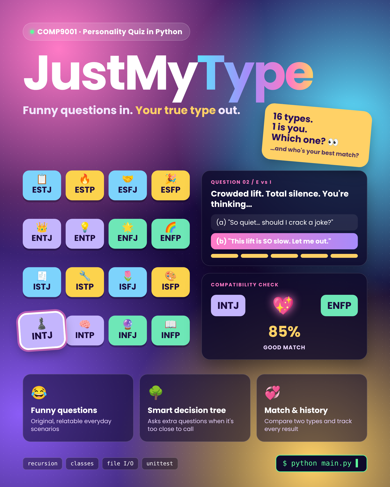

# JustMyType 🔮

**An MBTI personality quiz & compatibility analyzer that runs in your terminal.**

Funny questions in. Your true type out. 16 types, one of them is you. Which one? 👀



---

## ✨ Features

- 😂 **Funny, original questions**: relatable everyday scenarios answered on a 1–5 scale
- 🌳 **Smart decision tree**: a recursive 4-level tree (E/I → S/N → T/F → J/P) that asks extra questions when your answers are too close to call
- 📊 **Your type, explained**: a profile for each of the 16 types plus a percentage bar for every letter
- 💞 **Compatibility check**: compare any two types (or two people who have taken the quiz) with a score out of 100 and an explanation for each dimension
- 🗂️ **Quiz history**: every result is saved to a CSV file; search by name or type and see type statistics

## 🚀 How to run

Requires Python 3. Only built-in libraries are used, so there is nothing to install.

```bash
python main.py                       # start the program
python -m unittest test_mbti.py -v   # run the automated tests
```

All files must be in the same folder.

## 🧠 How the quiz works

1. The tree has 4 levels (E/I, S/N, T/F, J/P) and 16 leaves, one per type.
2. At each level, 3 random questions from that dimension are asked and answered on a 1–5 scale (1 = strongly option a, 5 = strongly option b).
3. If the result lands between 40% and 60%, extra questions are asked one at a time until it is clear, up to 7 questions per dimension.
4. The majority direction decides which branch to follow, until a leaf (your personality type) is reached.

## 📁 Project structure

| File | Purpose |
|---|---|
| `main.py` | Program entry point: menu, user input and output |
| `quiz.py` | Decision tree: `Question` and `DecisionNode` classes, recursive tree building and traversal, recursive tie-breaking questions |
| `question_bank.py` | Loads and validates questions from `questions.txt` |
| `questions.txt` | Question bank; new questions can be added without changing any code |
| `personality.py` | `PersonalityType` class and the 16-type profile dictionary |
| `compatibility.py` | Rule-based compatibility score between two types |
| `records.py` | Saves results to `quiz_records.csv` and queries history |
| `charts.py` | Text-based bar charts for the terminal |
| `test_mbti.py` | Unit tests |

`quiz_records.csv` is created automatically after the first quiz.

## 🛠️ Python concepts used

Recursion · Classes & objects · File I/O (TXT and CSV) · Error handling · Dictionaries · Closures · Unit testing

## 📝 Notes

- The compatibility score is a simplified model created for this project, not a scientifically validated measure.
- All quiz questions are original and were written specifically for this project; they are not taken from any published personality test.
- MBTI is based on the work of Isabel Briggs Myers and Katharine Cook Briggs.

---

COMP9001 Final Project · University of Sydney · I-Hsiao Wang
